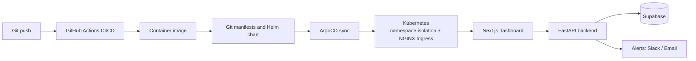
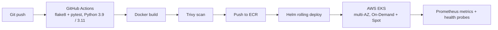

<!-- Optional banner: make a 1280x320 image in Canva and save it as assets/banner.png -->
<!--  -->

# Raj Tayde

**DevOps / Cloud Engineer** · B.Tech CS · Indore, India

Building production infrastructure, automated delivery pipelines, and cloud-native systems. Currently deep in Kubernetes and GitOps, moving toward Platform Engineering and AI infrastructure.

---

## Currently

**DevOps Intern @ Winlancer Technologies**: managing infrastructure and deployments for **17+ production applications serving 40K+ active users**.

| Result | Number |
|---|---|
| Deploy time (manual FTP to CI/CD) | **~1 hour → under 1 minute (~98%)** |
| Backend API server load (Nginx caching) | **down 80%** |
| Docker image size (own project) | **1 GB → 100 MB (90%)** |

---

## Tech I Work With

**DevOps & Cloud:** Docker · Linux · GitHub Actions · Bitbucket Pipelines · AWS (EC2, S3, IAM, ECR, ALB, EKS) · Kubernetes · Terraform · Helm · ArgoCD · Nginx · Bash · YAML
**Networking & Infrastructure:** DNS · Cloudflare · Reverse Proxy · TCP/IP · VPC · Subnets · Firewall · SSL/Certbot · Server Administration
**Security & Code Quality:** Fail2Ban · Trivy · SonarQube · OIDC · IAM least privilege
**Monitoring:** Prometheus · Grafana · Custom Alerting
**Backend:** FastAPI · REST APIs · JWT/OAuth
**Databases:** PostgreSQL · MSSQL · Supabase · Redis
**Languages:** Python · JavaScript · Bash

---

## Projects

### [LLM Drift Monitor](https://llm-drift-monitor-pi.vercel.app): Observability SaaS · Live

Monitors LLM response drift, latency, cost and model behavior across **9 providers**, with real-time drift detection and automated alerting.

**Stack:** FastAPI · Next.js · Supabase · Docker
**Infrastructure:** Kubernetes · Helm · ArgoCD (GitOps) · GitHub Actions CI/CD · Prometheus/Grafana · Terraform · AWS backup infrastructure

<!-- Add a screenshot:  -->

### [Movie Sentiment API](https://github.com/Raj-spy/Movie-api): DevOps Pipeline Project

**Infrastructure:** Terraform · multi-AZ EKS · public/private VPC subnets · hybrid On-Demand + Spot nodes
**Pipeline:** OIDC-based GitHub Actions · Trivy scan · ECR · Helm rolling deployment, completing in **under 2 minutes**
**Reliability:** HPA · liveness/readiness probes · Redis graceful degradation
**Optimization:** **90% Docker image reduction (1GB to 100MB)**

### [Exam AI](https://github.com/Raj-spy/AI-powered-exam-platform): AI-Powered Test Platform

MCQ generation from topic and difficulty using Groq LLM, secure shareable exam links, and per-student analytics. Integrated with LLM Drift Monitor for production drift tracking.

---

## Production Engineering

**DevOps Intern · Winlancer Technologies Pvt Ltd** *(Jul 2026 – Present)*

* Replaced FTP-based manual deployments with automated CI/CD, cutting deploy time from **about 1 hour to under 1 minute (~98%)**
* Set up the GitHub organization and GitFlow workflow, with environment-specific **dev → test → main** deployments
* Reduced backend API server load by **80%** through Nginx caching and media restructuring
* Ran **zero-downtime database migrations** with blue-green deployments across production, API and development environments
* Secured servers with Cloudflare, firewall rules, Fail2Ban and SSL automation, and added SonarQube checks to the pipeline
* Automated scheduled backups with Bash and cron; handled production troubleshooting and rollbacks

**IT Intern · Indore Municipal Corporation** *(Dec 2025 – Jan 2026)*

* Analyzed infrastructure and deployment workflows across **4+ departments**
* Identified single points of failure and legacy bottlenecks, and delivered **10+ prioritized recommendations** for automation, CI/CD, containerization and monitoring

---

## Open Source & Community

* **Jenkins contributor:** PR #482 merged into `jenkinsci/echarts-api-plugin` (JENKINS-58404)
* **GDG Cloud Indore:** Vue.js components, UI fixes and performance work for a community platform used by 1,000+ developers
* **PyData Indore:** core team member

---

## Certifications

* **Introduction to Kubernetes (LFS158)** · The Linux Foundation · Oct 2025 · ID: LF-x8idlr17nj

---

## Contact

[tayderaj848@gmail.com](mailto:tayderaj848@gmail.com) · [LinkedIn](https://linkedin.com/in/raj-tayde-a3072b30a) · [GitHub](https://github.com/Raj-spy)
